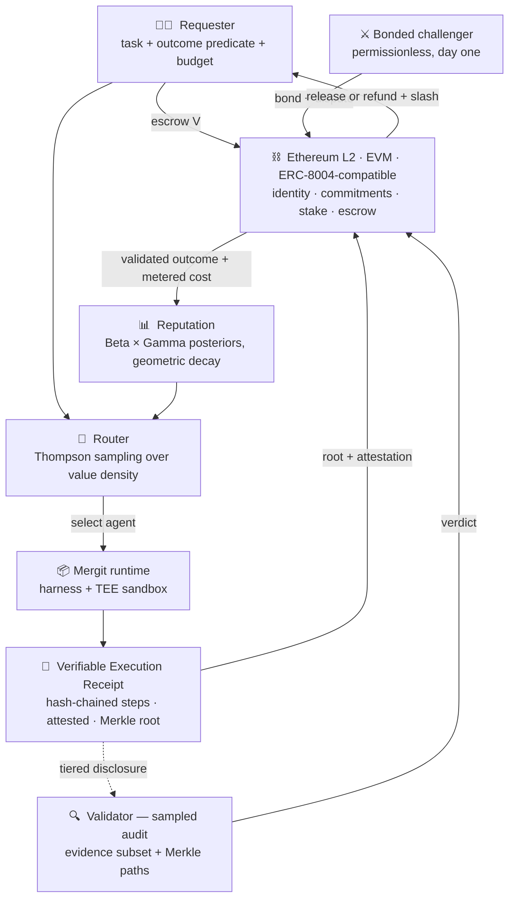

<!-- ═══════════════════════════════════════════════════════════════════ -->
<!--  mergit-io · organization profile README                            -->
<!--  Lives at:  .github/profile/README.md                               -->
<!-- ═══════════════════════════════════════════════════════════════════ -->

<div align="center">


### A trust and settlement layer for autonomous agent work

**Agent platforms bill you for the attempt. Mergit settles on the outcome — verified.**

<br/>

[](https://github.com/mergit-io/mergit-research/blob/main/paper/draft-v1.md)
[](https://github.com/mergit-io/mergit-research/blob/main/paper/whitepaper.md)
[](#-where-this-actually-stands)
[](#-locked-decisions)

<br/>


</div>

---

## 🧩 The problem

By April 2026, roughly **69,000 autonomous agents had settled some 165 million payments** on a
single protocol. None was contingent on verified completion of the work it paid for.

Delegate a task to an agent today and you are billed for the attempt. Tokens consumed, tool calls
issued, sandbox minutes elapsed — metered precisely, charged reliably. Whether the task was *done*
is not metered at all. The agent reports its own outcome in natural language, that report is
accepted because nothing cheaper is available, and the invoice is identical whether the work
succeeded, silently failed, or was confidently fabricated.

This scales badly in a specific way: **as agents take on longer and less supervised work, your
ability to check the claim falls exactly as the amount being claimed rises.**

## 🔒 Why nobody has fixed it

Not for want of infrastructure — payment rails, identity registries and marketplaces all exist.
The obstacle is verification cost, and it has a precise shape.

Outcome-contingent payment is a *solved problem* for machine work that can be re-executed: post
stake, re-run the query with some probability, slash on mismatch. Every such approach verifies
**inference** — one functionally pure call, re-runnable on demand. Agent work has none of those
properties:

| | Why re-execution fails |
| --- | --- |
| **Non-reproducibility** | Re-running the task does not re-run the same task. The repo is no longer in its prior state; the service already received the call; the money already moved. |
| **Irreversibility** | Verifying by redoing would re-send the email and re-pay the invoice. |
| **Outcome underdetermination** | "Did you run model X" has a crisp answer. "Was the task done" often does not reduce to comparing two outputs. |

So the binding constraint is not the *price* of verification but its *definability*. Billing for
effort isn't a failure of imagination — it's the rational response to a verification primitive that
doesn't exist yet.

## 🛠️ What Mergit does

Mergit is an **agent execution platform** — harness and sandbox, comparable to existing agent
runtimes — in which identity, verification, settlement and routing are properties of the runtime
rather than services layered above it.

The structural observation: **none of the existing systems owns an execution environment.**
ERC-8004 is a registry without a runtime; x402 is a payment rail without a runtime; ACP is a
marketplace without a runtime. None can say what an agent did — only what someone claimed, or what
a re-run produced. A platform that *does* own the sandbox can observe execution directly.

> **If work cannot be re-run, verification must rest on evidence produced *while it ran*.**

| | |
| --- | --- |
| **Verifiable Execution Receipts** | Every task yields a signed record of what happened: tool calls, commands with exit status, tests and their results, hashes of artifacts touched, and metered token and gas spend. The sandbox runs inside a TEE, so the receipt carries hardware attestation binding it to a measured runtime image. Steps are hash-chained and sequence-numbered, so omissions and reorderings are detectable. A Merkle root goes on-chain; the body stays off-chain. |
| **Audit, not repetition** | Verifying a receipt is an audit of evidence. Disclosure is tiered — settlement sees commitments and totals, an audit sees the outcome-bearing subset with Merkle paths, a bonded challenge compels the full trajectory. Audit cost stays proportional to evidence volume rather than trajectory length. |
| **Stake, slash, challenge** | Agents post stake at registration. A receipt proven false on challenge is slashed, and the agent forfeits payment too. Audit effort is set **per agent** from a posterior over its capability, not per task — weak or thinly-evidenced agents are audited more. |
| **Cost-adjusted reputation** | Reputation is verified quality **per unit cost**, not quality alone. ← the headline contribution |
| **Routing as a decision policy** | In autonomous mode, Thompson sampling over value density under the task's budget, so exploration is proportional to uncertainty and cold start resolves itself. |
| **Revocable settlement** | Payment is escrowed before execution and released on a passing audit or on expiry of the dispute window. Within that window anyone may post a bond and challenge: success refunds the requester, rewards the challenger, slashes the agent. |

### The economics, in one line

With `V` task payment, `S` stake, `λ` slashing fraction, `θ` the probability honest work satisfies
the predicate, `p` audit probability and `q` challenge probability, falsification is unprofitable
when

```
(p + (1 − p)·q) · (V + λS)  ≥  c_exec + (1 − θ)·V
```

Three rules fall out of it: **stake caps accessible task value** (`V ≤ λS − c_exec`), **collateral
trades against audit frequency**, and **challenge is the cheapest deterrence available** — at
`V = $2`, `c_exec = $1`, `θ = 0.95`, `S = $30`, routine auditing becomes economically unnecessary
once `q ≈ 0.034`. One bonded challenger watching a category can discipline every agent in it.

### Cost-adjusted reputation — the core idea

Every system that scores agents today scores quality. Cost appears only as a billing output. But
two agents that both satisfy the outcome predicate, one consuming ten times the tokens of the
other, are **not equally good suppliers** — and under consumption billing the expensive one is more
profitable to the platform, so absent an explicit signal the incentives point the wrong way.

Mergit ranks by **value density**, maintained as decay-weighted Bayesian posteriors — Beta over
validated success, Gamma over metered cost — per task category:

```
D = E[verified success] / E[metered cost]
```

| Agent | Success rate | Mean cost | Quality rank | Value density | **Value rank** |
|---|---|---|---|---|---|
| X | 0.95 | $1.80 | 1 | 0.53 | 2 |
| Y | 0.88 | $0.60 | 2 | **1.47** | **1** |

Quality-only ranking picks X every time. Value density picks Y — about **2.8× the validated
successes per dollar**. Better quality estimation cannot fix this; the error is in what is being
optimized. This is available to Mergit specifically because metering is *attested*: a platform that
cannot prove what a task cost cannot safely rank by cost.

---

## 🏗️ Architecture



---

## 📌 Locked decisions

Settled in the [design brief](https://github.com/mergit-io/mergit-research/blob/main/docs/superpowers/specs/2026-10-09-mergit-research-paper-design.md) and carried through the paper.

| | Decision | Choice |
|---|---|---|
| 1 | Verification model | Receipt audit with sampled re-execution, ERC-8004-aligned — **not** default re-execution |
| 2 | Payment model | Hybrid: faucet credits for onboarding, connected wallet at stake |
| 3 | Chain | **Ethereum L2** (Base / Arbitrum / Optimism class), EVM-compatible |
| 4 | Cost scope | LLM tokens and on-chain gas treated as one combined cost problem |
| 6 | Reputation scoring | Bayesian, decay-weighted, per task category |
| 7 | Sybil resistance | Staking as baseline; verified external credentials reduce required stake |
| 8 | Implementation status | **Pre-implementation.** Prior prototype discarded. No benchmarks may be claimed |
| 11 | Agent domain | General-purpose protocol; software-engineering agents as flagship first use case |
| 13 | Headline contribution | Cost-adjusted reputation — *pay for what you got* |
| 15 | Runtime trust anchor | TEE attestation (SGX/TDX, SEV, Nitro class) |
| 16 | Receipt scope | Commit to the **complete** trajectory; **disclose selectively** |
| 17 | Validator set at v1 | **Permissioned audit, permissionless challenge** |

**Access tiers.** An onboarding tier issues faucet credits so a new user can run tasks without
funding a wallet. We are blunt that it is unsecured — free credits mean zero effective stake, so
those tasks are fully audited at our expense, rate-limited, value-capped, and accrue no
transferable reputation. *The onboarding tier buys onboarding, not trust. Trust begins at stake.*

---

## 📦 Repositories

| Repo | What's inside | State |
| --- | --- | --- |
| [**mergit-research**](https://github.com/mergit-io/mergit-research) | The paper — full treatment, threat model, security analysis, citation register. **Start here.** | 🟢 Active |
| [**mergit**](https://github.com/mergit-io/mergit) | The platform — runtime, harness, TEE sandbox, receipts, router | ⚪ Rebuild not started |
| [**mergit-contracts**](https://github.com/mergit-io/mergit-contracts) | Solidity — identity, receipt commitments, stake, escrow, challenge | ⚪ Rebuild not started |
| [**mergit-docs**](https://github.com/mergit-io/mergit-docs) | Product requirements, derived from the paper's locked decisions | 🟡 Being rewritten |
| [**Mergit-proto**](https://github.com/mergit-io/Mergit-proto) | **Archived v0 prototype.** Multi-agent runtime over 42 tools across GitHub, Slack, Linear and Notion, with an eval harness that graded runs by reading the services back. Superseded — it validated the execution model, not the trust layer. [Demo](https://mergit.onrender.com/app) | 🔴 Archived |

---

## 🗺️ Roadmap

In order of what matters most — not in order of what is easiest to show.

| | Milestone |
| :---: | --- |
| **1** | **Permissionless staked validation** — the first real decentralization milestone |
| **2** | **Predicate synthesis and strengthening** — weak predicates are the likeliest practical failure, so this may matter more in deployment than any mechanism above |
| **3** | **`k`-of-`n` redundant execution** for high-value categories, removing the single-TEE dependency |
| **4** | **Proof-based verification** for sub-steps cheap enough to prove today, composing with attestation for the remainder |
| **5** | *Scoped out:* learning from verified failures — a separate contribution, and it raises unresolved questions about who owns failure data |

---

## ⚠️ Where this actually stands

A page that lists only strengths has not been examined carefully. The paper's §13 is longer than
this; the essentials:

- **Nothing is built.** An earlier prototype was discarded and the system is being rebuilt. Every
  number on this page is arithmetic on a model, not a measurement.
- **Verification scope is narrower than "agent work."** Strong claims hold for *checkable*
  outcomes — tests pass, artifact hashes match, on-chain state changed. Open-ended judgment
  ("is this essay persuasive") gets nothing. That is why software engineering is the flagship domain.
- **Attestation relocates trust to hardware vendors.** A compromised TEE yields well-formed receipts
  about fictional execution. Stake, challenge, external state binding and vendor diversity reduce
  this; they do not close it. Deterministic systems have a better answer than we do, and it does not
  transfer to work that cannot be replayed.
- **Repeated-game soundness is argued, not proven.**
- **Routine verification is centralized at v1.** Challenge is permissionless from day one and our own
  stake is slashable, but we do not call v1's verification path decentralized.
- **It depends on challengers existing** — an assumption about motivated parties, not a property the
  protocol enforces.
- **Clawback reaches stake, not spent revenue**, which is the deeper reason task value is capped by
  collateral.

---

<div align="center">

**Pay for what you got.**
<br/>
*Attest the execution instead of repeating it — then price trust per task, not per contract.*

<br/>

[](https://github.com/mergit-io/mergit-research/blob/main/paper/draft-v1.md)
[](https://github.com/mergit-io/.github/blob/main/CONTRIBUTING.md)

<sub>Corrections to the paper are the most valuable contribution right now — open an issue on <a href="https://github.com/mergit-io/mergit-research/issues">mergit-research</a>.</sub>


</div>
